# Aluna architecture

How Aluna works as built today. The vocabulary follows [CONTEXT.md](../CONTEXT.md),
and the reasons behind each decision live in the [ADRs](adr/).

## Contents

1. [Introduction](#1-introduction)
2. [What Aluna is and what it is not](#2-what-aluna-is-and-what-it-is-not)
3. [The premise](#3-the-premise)
4. [How it works](#4-how-it-works)
   - 4.1 [A sentence, end to end](#41-a-sentence-end-to-end)
   - 4.2 [The Intent Resolver](#42-the-intent-resolver)
   - 4.3 [The Core Builder](#43-the-core-builder)
   - 4.4 [Quality gates](#44-quality-gates)
   - 4.5 [Going live without a redeploy](#45-going-live-without-a-redeploy)
   - 4.6 [Serving records](#46-serving-records)
   - 4.7 [Generated UI](#47-generated-ui)
   - 4.8 [Evolving a capability](#48-evolving-a-capability)
   - 4.9 [Linking capabilities](#49-linking-capabilities)
   - 4.10 [Answering questions](#410-answering-questions)
   - 4.11 [Files](#411-files)
   - 4.12 [Concurrency](#412-concurrency)
   - 4.13 [Deleting a capability](#413-deleting-a-capability)
   - 4.14 [Recovery](#414-recovery)
   - 4.15 [Data model](#415-data-model)
5. [Trust boundary](#5-trust-boundary)
6. [Not built yet](#6-not-built-yet)
7. [Further reading](#7-further-reading)

## 1. Introduction

Aluna is a personal app that builds itself from what its user types. The browser
shows a desk with a prompt bar, a logo for each capability, and a window holding
the capability in use. On an empty desk, type *track the books I read* and Aluna
writes a capability called Books: a spec of the fields a book has, five functions
that create, read, update, delete and search books, a function that draws one book
as a card, and tests written before any of that code. The platform runs the tests
and its own checks against the code, and when they pass, Books goes live without a
restart or a deploy.

Most later changes are typed the same way. *add the date I finished* gives every
book a new field. *how many Le Guin books did I finish this year?* is answered by
read-only SQL, with the books the answer names linked to their records. *link each
book to its author* turns the author field into a pick-list of the records in
Authors.

Aluna runs on one machine for one person. Capabilities, records and files live in
one SQLite file, `data/omni-crud.db`, and two directories, `capabilities/` and
`storage/`.

## 2. What Aluna is and what it is not

Underneath the app, Aluna is a platform that writes, checks and hosts capabilities
while it runs. It ships with no domain model: no Books, no Recipes. A capability is
one subject's records together with the fields, rules, forms and cards that go
with them. A model writes it when the user asks, and Aluna stores it as a registry
row, a data table and a directory of generated code.

Aluna is not:

- A coding agent. The user states an outcome and never chooses a field type, a
  table change or a framework. During a build the model calls no tools and never
  touches the file system or the database, and nobody reviews code between steps.
- An app generator that hands over a codebase. A capability exists only inside
  Aluna. It has no repository, no deploy and no source the user edits.
- A site builder. How a capability looks is the platform's decision, and a request
  to change its colour, size, spacing, position or typography is refused. The model
  picks a layout and input modes from closed sets and writes card markup, which the
  Gate rejects when it leaves the design contract ([section 4.7](#47-generated-ui)).
- A hosted service. Generated code runs inside the server process, and the
  platform's checks are not a sandbox ([section 5](#5-trust-boundary)).

## 3. The premise

Aluna bets that a model can write everything that belongs to one subject, such as
books: its fields, its rules, its queries and how one record looks. The bet depends
on a fixed platform that owns everything else and runs the model's code before
anyone uses it.

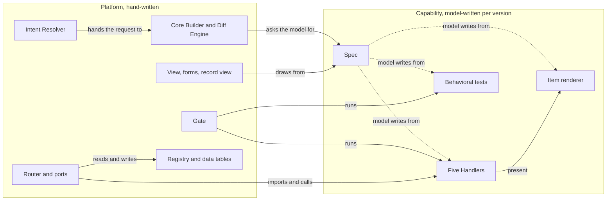

Three rules divide the work:

1. **The spec is the only authored source of a version's code.** The model writes
   the spec, then writes the Handlers, the item renderer and the behavioral tests
   from it, and the platform stores them together as one version. A change produces
   a complete new spec, and the platform works out which code to rewrite.
2. **The platform guards every write.** Generated code writes records only through
   a port bound to its own capability, and for update and delete to one record. It
   may read with any single `SELECT` written in its source, on a read-only
   connection limited to the tables it declared. Corruption, dropped tables and
   races all come from writes, so writes are where the platform puts its checks.
3. **Nothing goes live unchecked.** A capability becomes reachable only after the
   Gate has run its code on synthetic data, and only inside one SQLite transaction.
   When any step fails, nothing goes live and whatever was live stays. Only linking
   fails open, so a capability can go live without the links it would have made
   ([section 4.5](#45-going-live-without-a-redeploy)).

No platform code names a capability. One route, `/capability/:id/:action`, serves
them all ([section 4.5](#45-going-live-without-a-redeploy)), so a new capability
needs no new route, no restart and no deploy.

## 4. How it works

Every section below uses these terms.

| Term | Meaning |
|---|---|
| capability | One subject's records and everything that works on them, such as Books. |
| spec | The JSON description of a capability: fields, card and form choices, behavior and declared errors. |
| Action | One of the five operations every capability has: create, read, update, delete and search. |
| Handler | The generated TypeScript function for one Action. |
| item renderer | The generated function that draws one record as a card, in `item.ts`. |
| unit | One generated code file. A version has six: the item renderer and five Handlers. |
| version | An immutable directory holding one spec, its six units and, with the behavioral tier on, its tests: `v1`, `v2` and so on. |
| incarnation | One lifetime of a capability. Delete Books and ask for it again, and the new Books is a new incarnation. |
| registry | The SQLite table with one row per capability, pointing at its live version. |
| View | The collection surface the platform draws from the spec: the records, search and the create form. |
| record view | The surface for one record, which is its edit form. |
| active and hidden fields | Hiding a field keeps its column and values but removes it from forms, cards and the capability's own code. |
| read dependency | Another capability's table that one Action declares it reads. |
| ending | How a run finishes when nothing goes live: failed, stale, no change or cancelled. Whatever was live stays. |

Aluna is built on a small stack, and two of its parts carry the premise.

| Built with | What it does here |
|---|---|
| Bun and TypeScript | Runs the server. Bun imports a `.ts` file directly, so a generated Handler can be loaded the moment it is written, with no build step. |
| SQLite (`bun:sqlite`) | Holds the registry, the data tables and the metrics. One transaction covers a new table, the registry change and the metrics row, so a capability goes live atomically. |
| Hono | Routes HTTP and streams server-sent events. |
| htmx, Alpine.js and plain ES modules | Drive the browser, served as written. The server renders HTML fragments and generated code returns HTML strings, so there is no client build and no capability logic in the browser. |
| AI SDK and Zod | Make every model call a structured-output call validated against a schema, across OpenAI, Anthropic and OpenAI-compatible endpoints. |
| Recraft | Draws each capability's logo. |

The model is configuration. `OMNI_API_KEY`, `OMNI_MODEL` and `OMNI_BASE_URL` choose
the key, the model and the endpoint, and the endpoint's host decides the wire
format. Every language-model call goes to that one model. Logos go to Recraft,
configured by `RECRAFT_API_KEY` and `RECRAFT_BASE_URL`.

### 4.1 A sentence, end to end

The prompt bar posts the sentence to `POST /prompt`, which makes no model call. It
refuses a blank prompt or one over 4,000 characters, and otherwise creates a job in
memory. The browser then opens `GET /build/:id/stream`, a server-sent-events
stream, and the job runs while the stream is open. The stream carries `progress`
(a fact about the run: a stage starting, an Action's house rules being written, a
part being made or checked, a check under way), `narration` (the line a run that
did not land ends on), `fragment` (HTML for the window, the prompt bar or the desk's
provisional tile) and `commit` (the finished capability), plus preview events for a
developer panel, and it ends with `done`. The window draws the
facts as a sketch of the window being made, with Aluna's line under it; the words are
the window's own (`design/scripts/narration/voice.js`). Cancelling the job
aborts any model call in flight. Only one build runs at a time, and the rest wait
their turn ([section 4.12](#412-concurrency)).

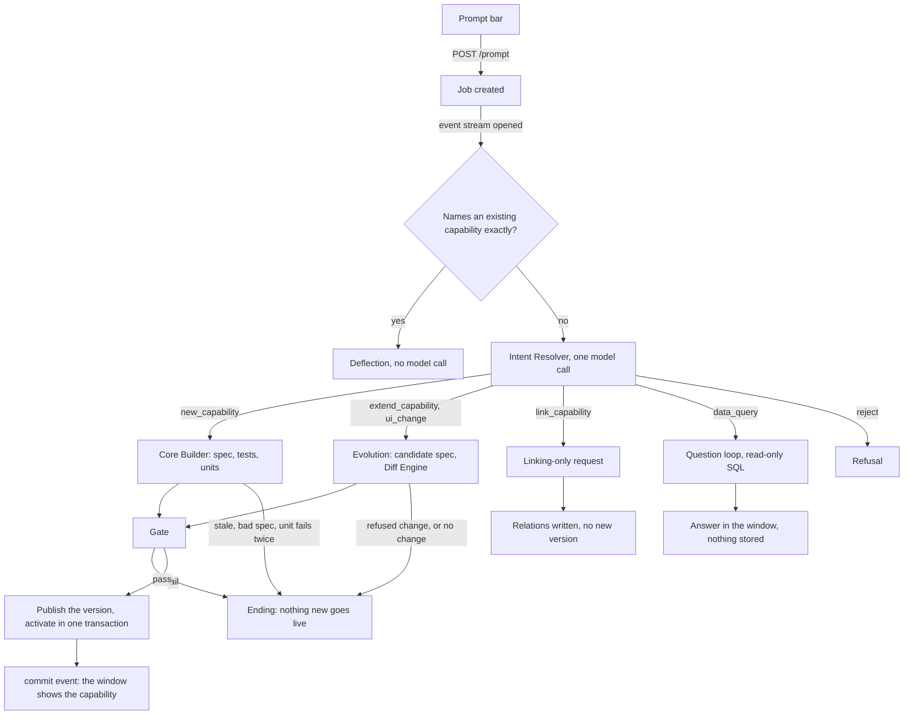

A new capability, start to finish:

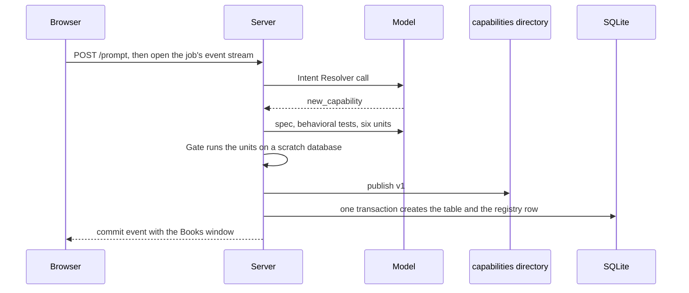

### 4.2 The Intent Resolver

Every sentence gets at most one Resolver call. A deterministic guard runs first. It
drops stop words and short words, folds singular and plural, and when the words left
are exactly the words of one existing capability's id, label or renamed label, the
job ends there with one line saying the user already has it, and the open view stays.
That path makes no model call and needs no API key.

The Resolver prompt carries the sentence, the capability open in the window, and
every active capability: its id, label, nouns, version, description and field list,
with no record content. The model returns one strict JSON object whose `type` picks
the branch:

| `type` | What follows |
|---|---|
| `new_capability` | The Core Builder writes a new capability. A separate capability (`resolution: namespace`) overlaps an existing one, and the Resolver must propose its id and label. |
| `extend_capability` | An evolution of the target capability. |
| `ui_change` | An evolution that may change only the capability's label or nouns, a field label, a list input mode, which text fields are long, a field hint, the card's fields or direction, or the layout. A change to what is stored, such as a new choice value, is an `extend_capability`, and any other presentation request, such as a choice's control or an option's wording, is a `reject`. |
| `link_capability` | A linking-only request that connects a field to another capability. |
| `data_query` | A question for the question loop. |
| `reject` | A fixed refusal. |

The object also names the target capability, a confidence that is recorded and
never acted on, and the related capabilities a build may link to.

The platform then checks what the model returned. A target is required for an
evolution, a linking-only request and a separate capability (the one it overlaps),
forbidden for a plain new capability and a refusal, and optional for a question.
The target of an evolution, a linking-only request or a separate capability must
exist. A proposed separate capability may not be a mechanical copy such as
"Contacts 2", and may not take a name in use or one reserved by a capability still
being deleted ([section 4.13](#413-deleting-a-capability)). The
Builder checks the name again once its turn comes.

The Resolver prompt tells the model to classify a styling request outside the
closed presentation list as `reject`. After an evolution's Diff, the platform
checks deterministically that a `ui_change` changed only what the table above
allows ([section 4.8](#48-evolving-a-capability)).

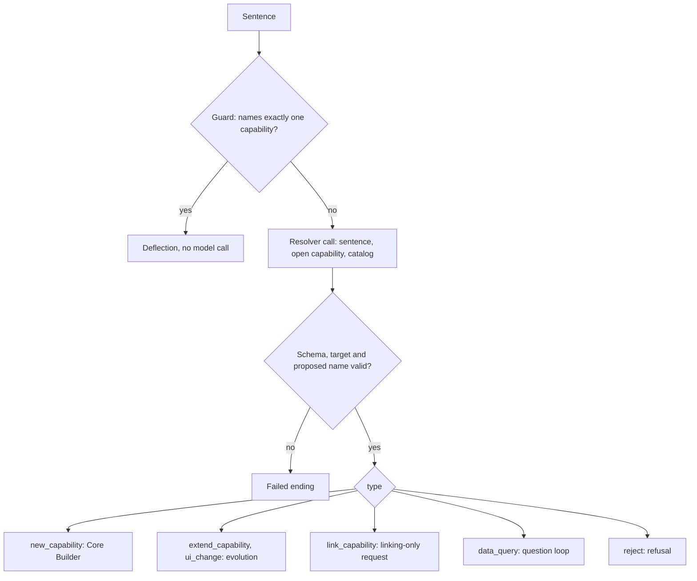

The Resolver takes no lease, so two prompts resolve in parallel. Their builds then
queue.

### 4.3 The Core Builder

A build is a fixed sequence of structured model calls, each validated against a
Zod schema and given five minutes.

The Builder first takes a ticket in a first-in, first-out queue and waits for the
exclusive build lease. When its turn comes, it compares the registry with the
catalog fingerprint, a hash of every active registry row except logos and
relations, taken when the Resolver ran. If the fingerprint changed, the target
moved to another version, or the proposed name was taken, the build ends as a stale
refusal without a model call. Otherwise it mints an incarnation id and opens a
`running` metrics row. Then come the stages:

1. Spec. One call writes the spec: id, label, nouns, a one-line description,
   fields, `ui_intent`, free-text `behavior`, declared errors, read dependencies
   and a logo brief. A field has a name, a
   label, one of nine types, a required flag, and options or limits where its type
   has them. The platform parses the spec strictly, checks that field names are
   unique, that there are at most 40 fields and that every field a card shows
   exists, among other rules, and refuses an id that is taken or reserved. Nothing
   repairs a bad spec: the build fails.
2. Link step. When the Resolver flagged related capabilities that have a field
   this one can link to, one call proposes relations, such as "author names a
   record in Authors". It runs beside the next
   two stages and has 30 seconds of grace after them. It fails open: if it fails or
   runs out of time, the build goes on without relations.
3. Behavioral tests. With the behavioral tier on, which is the default unless
   `OMNI_BEHAVIORAL_TIER` turns it off, one call per Action, two at a time, writes
   test cases as data: rows to seed, an input, the rows expected afterwards, and the
   markers the answer must carry, such as the code of a declared error. Their input
   is the spec's `behavior`, for each Action its fields, declared errors and read
   dependencies, and the name and type of every active field for writing fixtures,
   never code, because no code exists yet. Written first, the
   tests cannot be bent to fit the code, and they are frozen: no later step edits
   them. A suite that breaks the test contract fails the build. The contract
   requires, for each Action, at least one ordinary case, exactly one case per
   error declared on that Action and, for update and delete, exactly one case for a
   missing record.
4. Units. Six calls write the item renderer, then the five Handlers. Each unit must
   pass the source check as it arrives. On failure the error goes back to the model
   for one more attempt, and a second failure fails the build.
5. The Gate ([section 4.4](#44-quality-gates)), then publication and activation
   ([section 4.5](#45-going-live-without-a-redeploy)).

Each unit must pass the **source check**:

- one default export taking one parameter, async for a Handler and sync for the
  item renderer;
- no imports, and no `Bun`, `process`, `globalThis`, `eval`, `Function`, dynamic
  `import()` or prototype access;
- for a Handler: no database connection, no raw HTTP, no `INSERT`, `UPDATE` or
  `DELETE`, no SQL built at runtime, and no table outside its own and its read
  dependencies;
- for the item renderer: no field the card does not show;
- a strict TypeScript type check against the platform's contract declarations.

With the behavioral tier on, a clean build makes twelve model calls after the
Resolver (one spec, five test suites, six units), and seven with it off, plus the
link step when it runs and any repairs. The logo plays no part in the build: once
the first version is live, the desk asks for it, and Recraft draws it from the
brief in the spec ([section 4.5](#45-going-live-without-a-redeploy)).

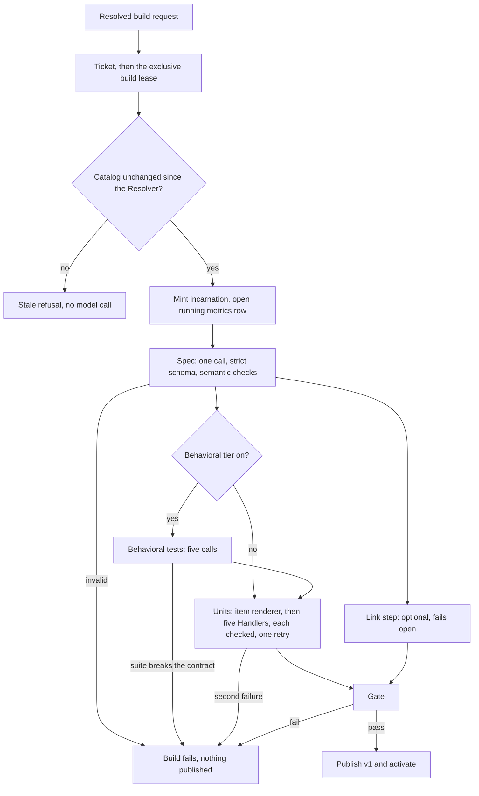

### 4.4 Quality gates

Checks run at two moments: while a version is built, and on every request after it
goes live.

| Check | When | What it stops | Section |
|---|---|---|---|
| Spec validation | each build | a malformed spec, a taken id | [4.3](#43-the-core-builder) |
| Candidate validation and the Diff Engine | each evolution | a retyped or dropped field, a difference no change fact explains | [4.8](#48-evolving-a-capability) |
| Test contract | each build and evolution | tests that skip a declared error or a missing record | [4.3](#43-the-core-builder) |
| Source check | each unit | imports, ambient runtime, raw writes, undeclared tables | [4.3](#43-the-core-builder) |
| The Gate | before publication | code that fails on real calls, card markup off the contract, failing tests | below |
| Publication | before activation | files that differ from what the Gate cleared | [4.5](#45-going-live-without-a-redeploy) |
| Wire contract and platform refusals | each request | malformed input, undeclared choices, over-long text, unknown files | [4.6](#46-serving-records) |
| Mutation and query ports | each request | writes outside the record, reads outside the declared tables | [4.6](#46-serving-records) |
| Enforcer and fragment sanitizer | each request | markup outside the design contract, scripts | [4.7](#47-generated-ui) |
| File admission | each upload | unlisted types, contents that do not match the extension's family | [4.11](#411-files) |

The Gate runs a candidate's code before any of it is written to the capability's
directory, on in-memory source and scratch databases. It fails closed: a rung that
still fails once its repairs are spent ends the build, and nothing is published. A
failure that points at no Handler gets no repair.

| Rung | Runs | Repair |
|---|---|---|
| Structural | always | none |
| Smoke | always | regenerate the Handler the failure points at, once |
| Design lint | always | regenerate the item renderer once, with the violation fed back |
| Behavioral | when the behavioral tier is on | regenerate the Handlers the failure points at, each at most once; tests are never edited |

Structural re-parses the spec, requires exactly the five Handlers, runs the source
check on every unit again, and type-checks the five Handlers together and the item
renderer on its own. It executes nothing.

Smoke runs a full cycle on a scratch in-memory SQLite: an empty read returns
nothing, then create one row, read it back, update each field, run a fixed set of
adversarial searches, and delete. When the spec has an optional file field, it
creates again leaving that field out. On a first build, smoke and behavioral also
require the real database's data tables to be unchanged afterwards.

Design lint renders the item renderer on a baseline record, on one record per shown
field (the card must change when that field changes), on file-type probes, and on
five hostile records: script injection, attribute breakout, style injection, tag
breakout and quote soup. It fails when the markup leaves the design contract, or
when the runtime enforcer would have to change it.

Behavioral runs the frozen tests, each case on a fresh scratch database seeded
through the real save path. When the item renderer is new in this run (a first
build, an evolution that rewrote it, or a design-lint repair), a failure in the HTML
a Handler returns is pinned on all five Handlers.

Every repair is checked again. A repaired unit passes the source check, and smoke
runs again on it. After a behavioral repair, structural runs too. Behavioral runs
last so that it tests the final item renderer. Results are recorded in the order
structural, smoke, behavioral, design lint.

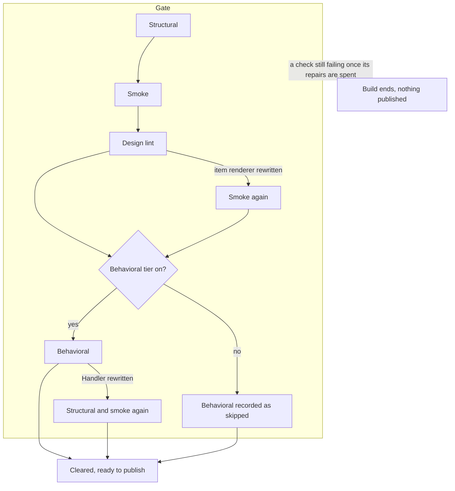

Publication accepts only a result the Gate issued, and only units whose bytes match
the ones it cleared. An evolution goes through the same rungs, copied units
included, though the behavioral rung may skip a copied test suite whose Handlers
were not regenerated. The Gate runs generated code inside the server process,
transpiled and called through `new Function`, and [section 5](#5-trust-boundary)
says what that does and does not protect.

### 4.5 Going live without a redeploy

One route serves every capability: `/capability/:id/:action`. On each request the
router reads the capability's registry row and imports
`<artifacts_path>/<action>.ts` by file URL. Each version lives at its own path, so
Bun's module cache never serves an old version in place of a new one. Nothing
restarts. Going live is a matter of pointing the registry row at a complete,
verified version, and publication and activation make that pointer safe to follow.

Publication writes the cleared version to
`capabilities/<id>/<incarnation>/.staging/<build>/`, with a manifest holding a
sha256 digest for every file. It verifies the staged copy from disk, then renames
the directory to `v1` or `vN+1` with a rename that refuses to replace an existing
directory. From then on the directory never changes.

```text
capabilities/
└── books/                    capability id
    └── 3f6c…/                incarnation id
        ├── logo.svg          drawn after the first version goes live
        ├── v1/
        └── v2/
            ├── snapshot.json manifest: files, digests, tier, how each unit was made
            ├── spec.json     the exact spec
            ├── item.ts
            ├── create.ts
            ├── read.ts
            ├── update.ts
            ├── delete.ts
            ├── search.ts
            └── tests/behavioral.json   only when the behavioral tier was on
```

Activation is one SQLite transaction. It creates the data table `cap_books` (or
adds columns to it, for an evolution), points the registry row at the new version
by compare-and-swap, wakes dormant relations that hold again, writes the link
step's relations, and marks the metrics row `success`. A relation the rules now
refuse is dropped. A failed wake or relation write is logged and skipped, so the
capability still goes live, unless SQLite has ended the whole transaction.
Once SQLite commits, the new version is
live. If anything fails before that, SQLite rolls back the table change and the
registry row. The published directory stays on disk, unreferenced, until
reconciliation removes it, at boot or before the next build or evolution publishes
([section 4.14](#414-recovery)).

After the commit, the job's `commit` event carries the new View into the window and
the capability's logo tile onto the desk, so the capability appears without a
reload. On a first build the tile is a placeholder, and its arrival asks the server
to have Recraft draw the logo; a page load retries one still missing, up to three
attempts in all. A reload rebuilds the desk from the registry.

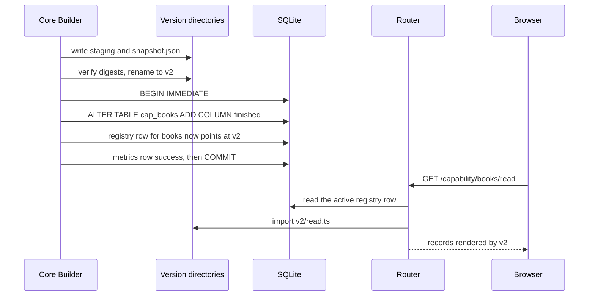

### 4.6 Serving records

Read and search are `GET` requests; create, update and delete are `POST`. A create,
step by step:

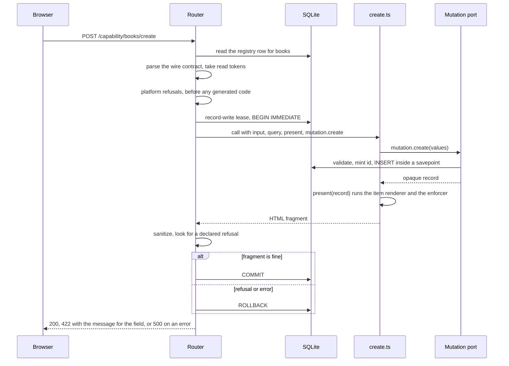

Three of those steps carry rules the diagram cannot show. The wire contract is
closed: a request may carry the field values, the platform's own `__aluna_` form
markers (such as the record picked in a linked field), exactly one target record for
update and delete, and for search only `q`, at most 512 characters and 16 terms.
Read tokens ([section 4.12](#412-concurrency)) cover the capability, its read
dependencies and the target of any submitted pick, and an update, a delete or a
search may also take tokens on capabilities linked to it. And before any generated
code loads, the
router refuses a choice value the spec does not declare, a string over its limit, a
file the ledger does not hold and a pick that names no record. The record-write
lease never queues, and the router stops waiting for the Handler after 10 seconds.

| Action | The Handler receives |
|---|---|
| create | `input`, `query`, `present`, `mutation.create` |
| update | `input`, `query`, `present`, `mutation.update` |
| delete | `input`, `query`, `mutation.delete` |
| read, search | `input`, `query`, `present` |

A Handler is never handed the id of the record it changes: update and delete get a
mutation port already bound to that record. The port accepts only active fields,
normalizes each value by its type, checks required fields on the resulting record,
mints the record's UUID, claims uploaded files and writes link rows, all inside a
savepoint. It refuses any write after the Handler has answered.

The query port has two methods. `query.all` runs one `SELECT` from the Handler's
source and returns only the columns it declared, as the types it declared.
`query.records` returns opaque record handles, the only thing `present()` accepts,
so a Handler cannot invent a card. Before a query runs, `EXPLAIN` confirms that it
opens only the capability's data table and its read dependencies. On the
capability's own table it may read no hidden field and no `extra`, and through
`query.all` not the record `id`; a dependency's table is bounded by table, not by
column. The query then runs on a connection opened read-only with `query_only` set.
Platform tables are out of reach.

Generated search SQL calls `platform_search_normalize()`, which the platform
registers through a small C extension compiled on first use. Search therefore
ignores case and accents where SQLite's `LIKE` and `lower()` would not.

### 4.7 Generated UI

The platform draws every surface a capability has: the View (the collection, with
its search and create form), the record view (which is the edit form; there is no
read-only view), the delete confirmation and every control. It draws them from the
spec on each request, without a model call.

The model contributes two things. In the spec's `ui_intent` it picks, from closed
sets, which fields a card shows, a `feed` or `grid` layout, how a list field is
typed, how a choice is shown and which text fields are long, and it writes free
text for the card's direction and an optional hint per field. On a first build,
when the card shows a file, the platform draws the layout itself from the
incarnation id. The model also writes the item renderer, a synchronous function
that turns one record into the inner markup of its card.

Opening a capability returns the View, whose records region then loads from `/read`
and runs the generated `read.ts`. For each row, `read.ts` calls `present(record)`,
which runs the item renderer on a copy of the record holding only the fields the
card shows, passes the markup through the enforcer and wraps it in the platform's
card. The router sanitizes the whole fragment once more on its way out.

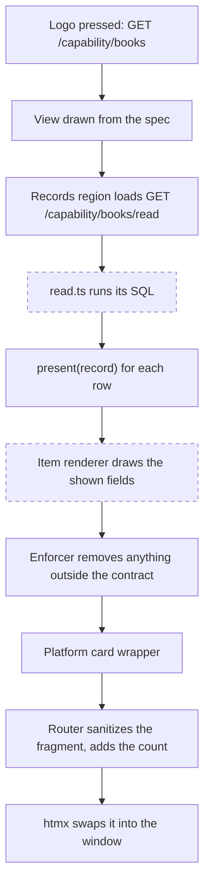

Dashed boxes are model-written code. Everything else is the platform's.

The design contract lets card markup style itself only with the shared design
tokens, on three axes (colour, type size and spacing) written as `var(--token)`,
and with the shared layout classes. Card markup may never declare a font, a border,
a radius, a shadow, a transform, a position other than `static` or `relative`, a
raw colour, `url()` or `!important`. Width and most other properties are free.

The enforcer rewrites card markup with Bun's `HTMLRewriter` against an allow-list of
elements. It removes some elements together with their content, among them
`script`, `style`, `svg` and `iframe`. It drops `id`, `href`, `role` and every
`on*` attribute, and keeps a media URL only when it is same-origin or a
`data:image`. Enforcing twice gives the same result as enforcing once, so a second
pass cannot turn text the first pass left inert into live markup. The router's
fragment sanitizer then strips from the Handler's whole fragment any scripts,
frames and plugins, document-level elements such as `base`, `meta` and `link`,
inline handlers, Alpine directives, code-carrying or out-of-band htmx attributes,
and dangerous URLs.

### 4.8 Evolving a capability

An evolution keeps a capability's id, incarnation, data table, records and logo,
and adds a version.

1. One call returns a complete candidate spec, never a patch. The prompt holds the
   live spec with its hidden fields, the lifecycle of every field, and the other
   capabilities the change may read.
2. The platform validates the candidate: first against the spec schema, then
   against the live spec, reporting every violation of the second kind at once.
   The id and the logo brief may not change. Every field of the live spec, hidden
   ones included, must come back exactly once with the same type, and one that
   stays hidden must come back unchanged. A new field is born active. Hiding a
   field changes nothing but its lifecycle. Choice values are append-only, and a
   file field may only widen what it accepts. Any violation ends the run.
3. The Diff Engine compares the live and candidate specs and emits typed change
   facts: a new field, a hidden field, a field made required, a new layout, changed
   behavior text, and twenty more. It then removes from both specs every part some
   fact accounts for and requires what is left to be identical, so a difference no
   fact explains stops the run. A `ui_change` that produces a fact outside its
   allowed list ([section 4.2](#42-the-intent-resolver)) is refused here, and so is
   a new or lower length limit that a stored value already breaks. No facts means
   no change: the run ends with a no-change ending, measured in the metrics, and
   makes no version.
4. From the facts the Diff Engine derives a work plan: platform work, which of the
   six units to regenerate, and whether the whole test suite must run. A unit the
   plan selects is regenerated. One it does not select is copied byte for byte from
   the live version and never enters a prompt, unless a Gate repair later rewrites
   it. When regenerating, the model sees the old source only if the platform has
   proven it still fits the new contract and names no hidden field.
5. With the behavioral tier on, each Action's test suite is carried over when its
   inputs are unchanged and it still fits the contract, and regenerated otherwise.
   The inputs are the spec's `behavior`, the Action's declared errors and read
   dependencies, and the fields it handles: every active field for create and
   update, the searchable ones for search, none for read and delete. The whole
   suite runs when `behavior` changes, when the card's fields change, or when the
   item renderer is regenerated along with a Handler.
6. The Gate, publication and activation run as for a new capability. As in every
   build, every committed version is verified before publication. One check is the
   evolution's own: the capabilities this one reads from are checked again just
   before COMMIT. The activation transaction adds any new columns and swaps the
   registry row to `vN+1`.

| Change | Units regenerated |
|---|---|
| new field | create and update, plus search for a `string`, `choice` or `string[]` field |
| field hidden or brought back | create and update, plus search for those same types |
| field made required or optional | create and update |
| choice value added | create and update, plus the item renderer when the card shows the field |
| field label, choice option label, or accepted file types | the item renderer, when the card shows the field |
| card fields or card direction | the item renderer |
| collection layout | the item renderer |
| read dependency or declared error | the Handlers of the Actions it names |
| free-text `behavior` | all five Handlers |
| a change in whether any active `file` field, or any active `file[]` field, exists | all five Handlers |
| capability label, nouns, input modes, hints, length limits, retired choice options | none: platform work only; with the behavioral tier on, a length limit or a retired option also gets new create and update tests |

No stored value is ever rewritten, except that a relation the evolution wakes brings
its linked field to the target's current text ([section 4.9](#49-linking-capabilities)).
The only table change is a nullable `ADD COLUMN` for a new field, so existing records
hold NULL there. A hidden field keeps its
column and its values; the capability's own code never sees it, and bringing it
back restores the values. A field's type never changes: the candidate prompt forbids it
and the DDL refuses it. To store a value differently, the user asks for the old field to
be hidden and a new one added.

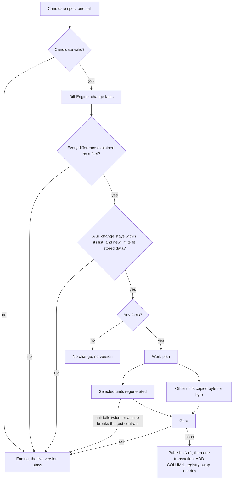

Versions move through these states. The registry points at exactly one of them.
Older directories are kept and verified by reconciliation, and nothing restores
them.

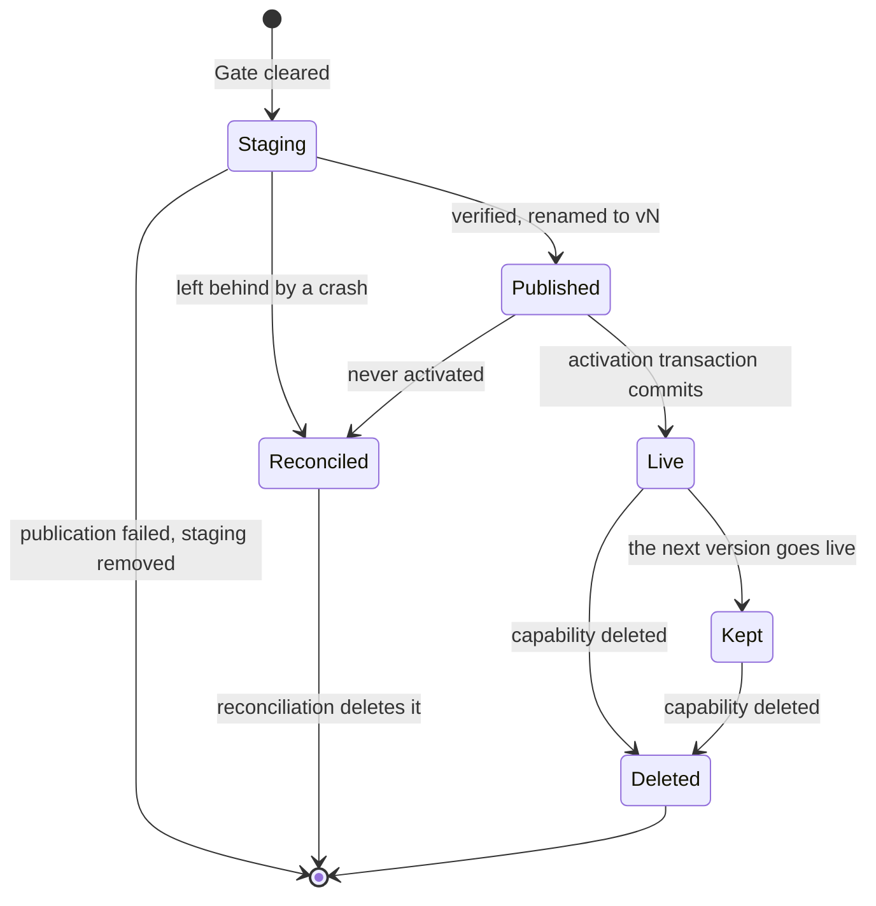

Renaming a capability is not an evolution. The rename control writes
`display_label_override` on the registry row, which wins over the spec's label. It
makes no version and calls no model, it leaves the id, data table, links and logo
alone, and later evolutions keep it.

### 4.9 Linking capabilities

A relation says that a text field in one capability names records in another: the
author field of Books names records in Authors. The relation lives on the registry
row, outside the spec. An evolution never changes an existing relation, though its
link step may add relations for the fields it adds. Which author each book picked is
a row in the link table, `capability_links`. The field keeps its own text, and
generated code never sees a link.

On the source side a relation needs an active single-line text field with no
relation of its own, and on the target side an active single-line text field of
another capability. A source with a length limit needs a target whose limit is no
larger, while a source with no limit takes any target. Following relations from the
target field must never lead back to the source field.

Three things create relations, each checked by the same rules and written by the
same relation code: the link step inside a build or evolution, which calls the
model and fails open; the link control in a form, which calls no model; and a
linking-only request such as *link each book to its author*, which runs the link
step alone on the live spec, with no new version and no Gate.

When the link control or a linking-only request writes a relation, the matching
scan compares each book's author text with the names in Authors, trimmed and
case-folded. A name that matches exactly one author gets a link row. The rest keep
their text and show a broken-link mark until the user picks an author. The scan also
runs at boot, and when an activation brings a dormant relation back.

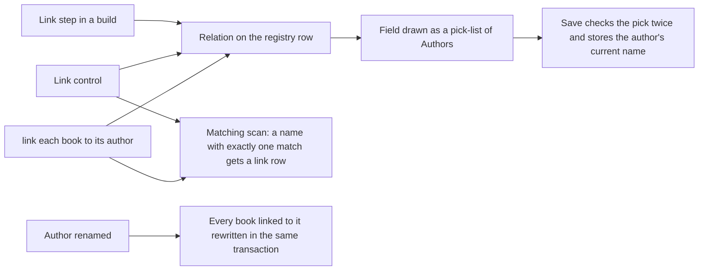

From then on:

- the router checks a submitted pick before the Handler runs and again inside the
  transaction;
- editing an author's name rewrites every book linked to it in the same
  transaction, and carries the change on to any field linked to the one it rewrote;
- deleting an author clears an optional linked field, and leaves a required one
  with its text and the broken-link mark;
- clearing an author's name drops its link rows, and the books keep their old text
  with the mark;
- an author's record view lists the books that link to it;
- search also returns records reached through links;
- a relation goes dormant when its rule stops holding, because a field was hidden,
  made long text, or given a limit the rule no longer allows, and comes back, with
  its target's current text, at the next activation where it holds again;
- the unlink control removes a relation and its link rows, and the records keep
  their text.

### 4.10 Answering questions

A `data_query` builds nothing and keeps nothing of what it read or said. The
question loop first takes a read token on every capability at once, all or none. Inside a Worker thread it
attaches the database read-only and builds temporary views over it. Each view shows
`id`, `created_at` and the active fields, and withholds file keys and any text that
might hold one. A further view shows the link rows of relations that hold.

On each turn the model makes one decision: read with one SQL statement through its
single tool, `run_read_only_query`; answer; or report that the desk has nowhere for
the subject. The platform checks a read with `EXPLAIN` on the main read-only
connection, bounded to the tables and columns the views expose. The Worker then runs
it with `query_only` set, and refuses `ATTACH`, `PRAGMA` and multiple statements. A
step may carry 16 KiB and a whole question 64 KiB, and past those the platform
refuses rather than truncates.

The loop allows ten steps. A refused or failed statement counts as a step, and so
does an unreadable decision. A claim that the desk has nowhere for the subject, made
before any collection was read, costs a step and is sent back the first time; a
second one is treated as an answer. The model sees what went wrong each time, and
every step sends a line of progress to the window, which adds a square to the band over
it. The sentence the question ends on is marked as the ending, and the band goes when it
lands. After the tenth step the model
gets one last turn, which runs no statement. An answer, or a nowhere claim made
after reading, ends the question as usual, and anything else ends it with a fixed
sentence saying Aluna could not work it out.

An answer needs statements that ran and matched. When no statement came back at
all, because every one failed or was refused, the question ends with a fixed
"nothing worked" sentence. When statements ran but matched nothing, it ends with a
"nothing found" sentence, which names the collections read when there were any.
Otherwise one more call writes the answer, at most 2,000 characters, and
names up to 20 records. The platform strips from the sentence every record id the
steps returned. It links a phrase to a record only when the phrase appears as whole
words in a cell of a step's row, that row also returned the record's id, the cell
equals one of the record's own text or choice values, exactly one of the
capabilities read by the steps that returned the id holds it, and that capability
has a record view.

A nowhere claim made after reading ends as "nothing found" when the steps matched
nothing. Otherwise one more call names the missing subject and writes her sentence about
it, from the question alone. When the subject names something already on the desk, or
nothing of the user's own while a window is open, the question is answered instead.

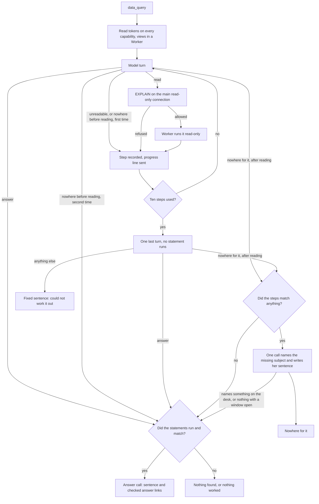

The question stores nothing of what it read or said. Its one metrics row holds the
step count and the elapsed time. A deletion that closes a read gate cancels a
running question, and while a deletion drains, a new question is refused.

### 4.11 Files

Generated code never handles a file's bytes. It sees `{url, name, kind, mime, size}`
and passes it through.

An upload is one streamed request per file to
`/capability/:id/:incarnation_id/upload/:field`. Before any byte is stored, the
platform checks that the extension is on its allow-list, that the field accepts the
file's family (image, video, audio or document), and that the declared type does
not contradict the extension. While the bytes stream, it matches their head against
that family's signatures; a text file is read to its end, and a DOCX is checked
again once written. SVG, HTML, HEIC and TIFF are refused. One file may be at most
500 MiB unless `OMNI_MAX_FILE_BYTES` says otherwise.

The bytes land in `storage/.incoming/<key>`. A `pending` row goes into the file
ledger, and only then is the file renamed into `storage/<key>`. The ledger is the
only record of who owns a file, and it is also the cleanup queue.

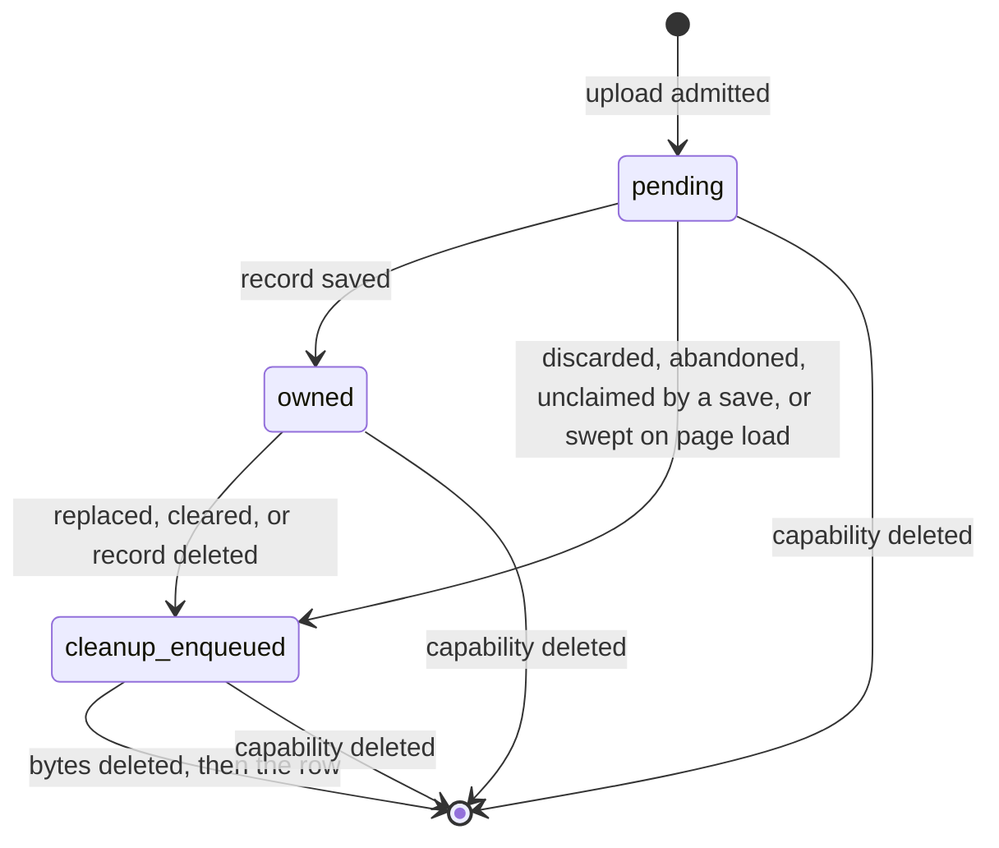

When a capability is deleted, its ledger rows go in the deletion transaction and
the bytes after it.

`GET /files/:key` serves only files a real upload could have written, with byte
ranges and a Content Security Policy per family. Images, video, audio and PDFs open
in the browser; other documents download. A script or style load, or a page's own
fetch, gets a 404, except a player loading audio or video.

### 4.12 Concurrency

Writes are serialized; reads are not. The mutation coordinator grants one lease at
a time, of four kinds:

| Lease | Taken by | When the coordinator is busy |
|---|---|---|
| build | builds, evolutions, linking-only requests | waits in a first-in, first-out queue |
| platform | ledger writes, capability renames, links and unlinks, logo writes, deletion-cleanup retries, metrics rows for refusals, deflections and questions | waits in the same queue |
| record | saving or deleting a record | refused at once while anything holds the lease or waits for it |
| deletion | deleting a capability | refused at once while anything holds the lease or waits for it |

A deletion must not drop a table while a request still reads it, so every
capability incarnation has a read gate. Each request takes a read token from every
read gate it needs, all or none, and a question takes one from every read gate.
Apart from a pick's target, a token on a linked capability is taken on its own, and
skipped when that capability's read gate is closing.
Only a deletion closes a read gate: it aborts the readers and waits up to 15
seconds, and if they are still running, the read gate reopens and the deletion is
refused.

The catalog fingerprint that a waiting build checks leaves out logos and relations,
so a new link or an arriving logo never makes a waiting build stale. An evolution
never closes a read gate. A request in flight finishes on the version it started
with, and the additive table change keeps its SQL valid.

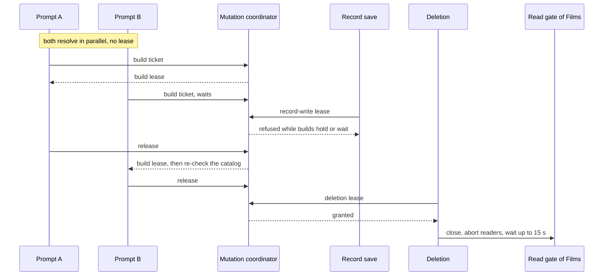

Reads take no lease, but every Handler read goes through one synchronous read-only
connection, so a slow query holds up the requests behind it. Only the question loop
runs SQL off the main thread.

### 4.13 Deleting a capability

Deletion starts from a confirmation. It is refused while another capability
declares a read dependency on the one being deleted; a relation never blocks it.
The deletion collects an owned-resource manifest, the list of everything on disk
that belongs to the incarnation: its incarnation directory, with every version and
the logo, and every file key the ledger holds for it.

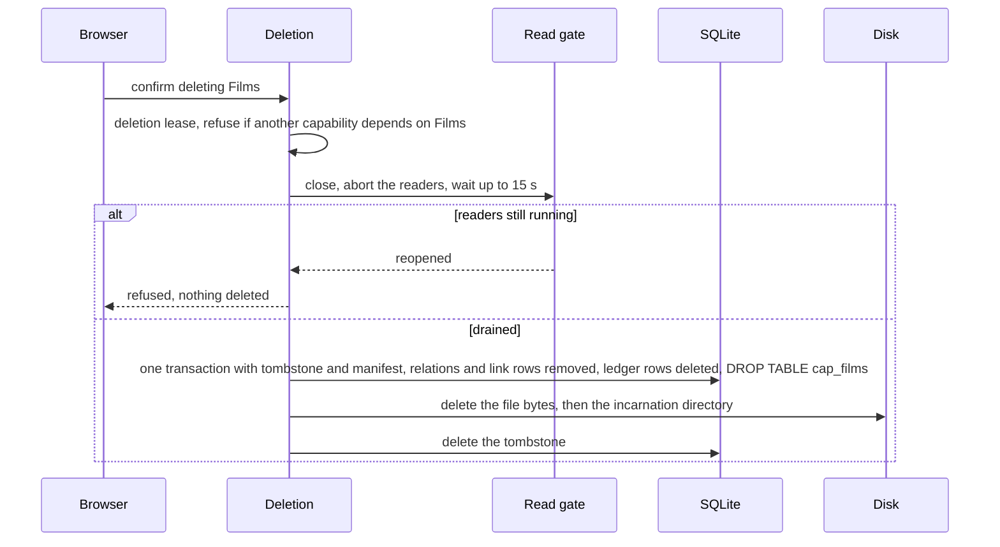

The tombstone is the registry row turned unroutable. It keeps the id reserved until
cleanup finishes. A failed cleanup retries after 1, 5 and 30 seconds, and again on
the next page load or boot. When Authors is deleted, every book keeps its author
text as plain text.

### 4.14 Recovery

A file system change cannot join a SQLite transaction, so every store change is
ordered so that a crash leaves something boot can repair. Deletion and file cleanup
commit their claim in SQLite first and do the file work after. Uploads and
publication write files first: boot empties upload staging, and removes a staged or
published version only when its metrics row proves it never went live. Either way,
a file already gone counts as done.

Before it serves a request, boot:

1. moves the model-provider and Recraft keys out of `process.env`;
2. runs the migrations and marks any build still `running` as `interrupted`;
3. clears upload staging;
4. retries unfinished deletions and drains the file-cleanup queue;
5. rebuilds the read gates from the registry;
6. reconciles versions: it verifies every version a capability has published and
   removes staging directories and published versions that the metrics prove never
   activated. A corrupt version, a leftover it cannot prove never activated, or an
   unknown entry stops boot;
7. settles logos left mid-generation;
8. matches linked names that are still unmatched.

A page load sweeps `pending` uploads, because a reload has destroyed the forms that
held them. It also retries owed deletion and file cleanup and settles logos again.

### 4.15 Data model

| Store | Holds |
|---|---|
| `data/omni-crud.db` | the registry, one data table per capability, the file ledger, the link table and the metrics |
| `capabilities/` | immutable version directories and logos |
| `storage/` | uploaded file bytes, named by UUID |
| process memory | jobs, leases and read gates |

SQLite runs in WAL mode. The server holds two connections, a read-write one that is
the only write path and a read-only one with `query_only` set, and each question's
Worker attaches the file read-only on its own. Every table is `STRICT`. Nothing
declares a foreign key: each relationship below is logical and kept by platform
code. Platform tables change only through ordered, additive migrations, recorded in
`schema_migrations`.

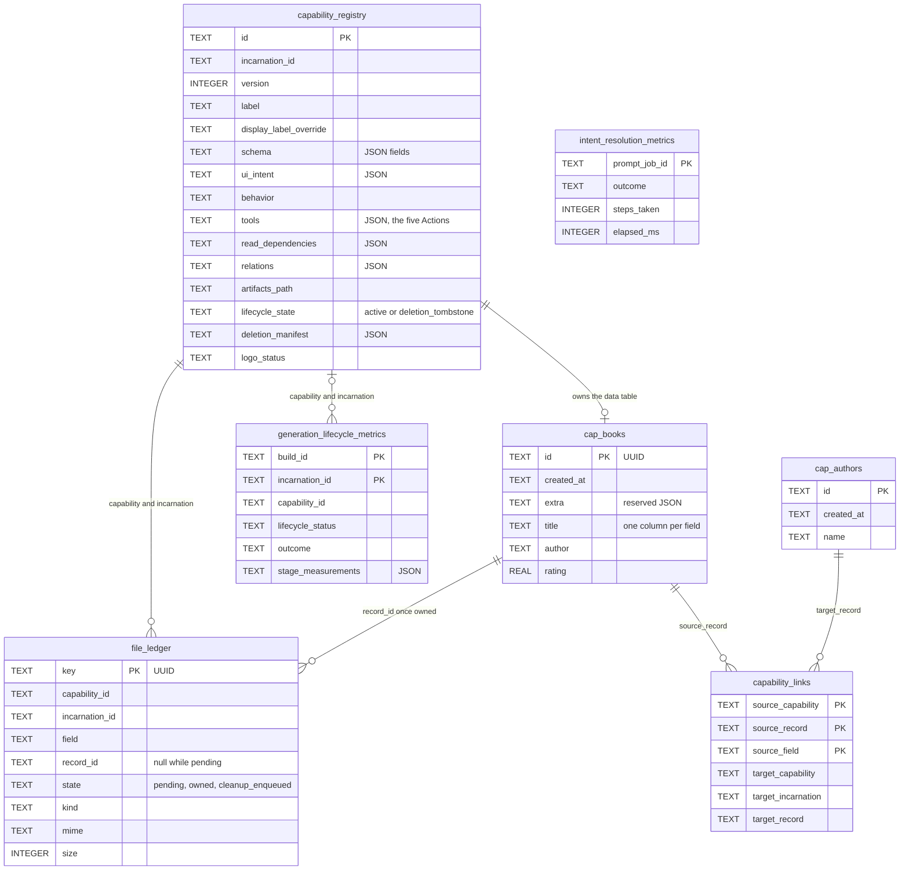

`capability_registry` has one row per capability and holds only the live version;
older versions exist only as directories. A deletion turns the row into a tombstone
in place. A version swap rewrites the spec columns and the logo brief, which
validation holds equal, and never the logo state, the rename override or the
relations, which change only through their own functions.

`cap_<id>` is one data table per capability. It starts with three platform columns
(`id`, a UUID; `created_at`; and `extra`, a JSON column reserved and unused) and
adds one column per field. No field column is `NOT NULL`: the mutation port
enforces required fields, and a column added later must hold NULL for older
records. Data tables carry no index beyond the one SQLite builds for `id`.

| Field type | Column | Also enforced |
|---|---|---|
| `string` | TEXT | a length limit, 10,000 characters when none is declared |
| `number` | REAL | finite |
| `boolean` | INTEGER | `CHECK` 0 or 1 |
| `date` | TEXT | `YYYY-MM-DD` |
| `datetime` | TEXT | ISO 8601 |
| `choice` | TEXT | a declared value, checked by the router and the mutation port; no `CHECK`, so values can be appended |
| `string[]` | TEXT | `CHECK` a JSON array; the mutation port admits only strings, 10,000 characters in total |
| `file` | TEXT | `CHECK` a JSON object; the save writes key, kind, mime, size and name |
| `file[]` | TEXT | `CHECK` a JSON array; at most 20 files unless `OMNI_MAX_LIST_FILES` says otherwise |

`file_ledger` records every uploaded file's owner and state
([section 4.11](#411-files)). `capability_links` records which target record each
linked field picked, keyed by the source record and field
([section 4.9](#49-linking-capabilities)).

`generation_lifecycle_metrics` has one row per admitted build or evolution. It opens
as `running` and closes as `success` (activated, or no change), `failed` (stale,
cancelled, or the stage that failed) or `interrupted`. A stale refusal at the head
of the queue is written already closed. The row holds token counts, timings, each
Gate rung's outcome and each unit's attempts. Reconciliation reads it as proof that
a version never activated, and in development the developer panel shows the five
latest rows. `intent_resolution_metrics` records refusals, deflections and
questions, and nothing reads it yet. A third table,
`generation_metrics`, is unused. Metrics outlive the capabilities they measure.

## 5. Trust boundary

Generated code runs inside the server process, in the Gate and when serving
requests. Five things limit what it can do:

- the source check: no imports, no ambient runtime such as `Bun` or `process`, no
  `eval`, and no SQL built at runtime;
- the ports: no database connection, no raw write SQL, and a table scope checked
  with `EXPLAIN`;
- the read-only connection for every read;
- the enforcer and the fragment sanitizer on all the markup it returns;
- the model-provider and Recraft keys, which boot moves out of `process.env` before
  any generated code loads.

In the browser, pages carry a Content Security Policy of `default-src 'self'` with
frames, objects and `<base>` closed. Scripts may use `eval`, because Alpine needs
it, and inline styles are allowed. htmx itself runs with script tags and eval
disabled.

These catch a model's mistakes. They are not a sandbox: code written to escape them
can. The Gate puts no time limit on the code it runs, and at request time the router
stops waiting for a Handler after 10 seconds without stopping the code. Aluna
therefore listens only on `127.0.0.1`, for one person.
[ADR-0003](adr/0003-ai-provider-spine-and-coding-harness.md) explains why there
is no process sandbox.

## 6. Not built yet

- Suggestions from use. Aluna does not yet watch what the user does or suggest
  changes from it.
- Restoring an older version. Earlier versions are kept, and nothing restores them.
- A dashboard over the metrics.
- Reading documents. A document is stored and served, never read for its content.
- A process sandbox for generated code.

## 7. Further reading

- [CONTEXT.md](../CONTEXT.md), the vocabulary.
- [research.md](research.md), the research behind the premise.
- The ADRs:
  - [0001](adr/0001-product-style-and-voice.md) product style and voice
  - [0002](adr/0002-sse-transport-conventions.md) SSE transport conventions
  - [0003](adr/0003-ai-provider-spine-and-coding-harness.md) AI provider spine and the code-writing harness
  - [0004](adr/0004-capability-artifact-contract-and-validation-isolation.md) capability artifact contract and validation isolation
  - [0005](adr/0005-opinionated-capability-ui-design-contract-and-gate.md) opinionated capability UI: platform presentation, one item renderer and a closed design contract
  - [0006](adr/0006-capability-evolution-versioning-and-diff-contract.md) capability evolution and deletion: total diffs, immutable publication and frozen intent
  - [0007](adr/0007-capability-logo-contract.md) capability logos: one accepted artwork per incarnation, immutable delivery and bounded retry
  - [0008](adr/0008-ephemeral-query-loop-and-spoken-answer.md) the ephemeral question loop and the spoken answer
  - [0009](adr/0009-files-platform-admission-and-the-file-ledger.md) files: the platform admits and stores, the ledger owns
  - [0010](adr/0010-record-addresses-and-record-links-in-answers.md) record addresses and answer links
  - [0011](adr/0011-linked-capabilities.md) linked capabilities
